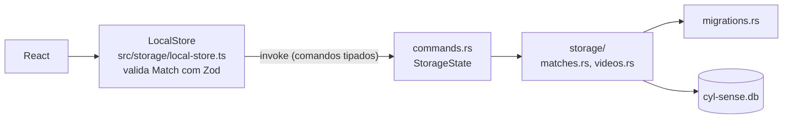
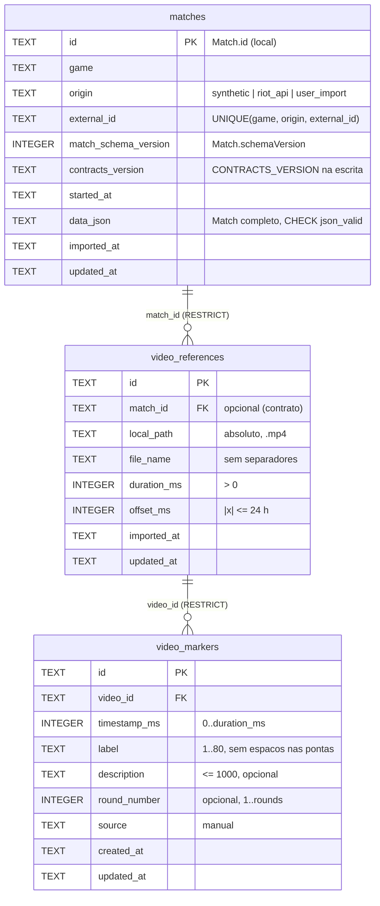

# Persistencia local do desktop (SQLite)

Decisao e alternativas: [ADR 0004](../decisions/0004-sqlite-local-e-postgresql-no-backend.md).

## Camadas

- O front-end so chama comandos nomeados; nao existe comando que execute SQL.
- `StorageState` guarda o banco aberto **ou** o erro de abertura: o app abre mesmo com banco corrompido/inacessivel e o rodape mostra `banco indisponivel`.
- Uma unica conexao protegida por `Mutex`; comandos `async` (fora da thread principal).

## Localizacao

| Ambiente | Caminho |
|---|---|
| Windows | `%LOCALAPPDATA%\gg.cyl.sense\data\cyl-sense.db` (`app_local_data_dir`) |
| Builds de debug | `CYL_SENSE_DATA_DIR` (se definido) substitui o diretorio; **ignorado em release** |
| Testes Rust | diretorio temporario por teste (`tempfile`) ou banco em memoria |

Diretorio local (nao roaming) porque o banco guarda caminhos de videos desta maquina. Nunca dentro do repositorio, de `src/`, `src-tauri/` ou de diretorios de build; `*.db`, `*.sqlite` e `*.sqlite3` estao no `.gitignore`.

## Abertura

1. Cria o diretorio se preciso; caminho que e diretorio ou pai invalido => `unavailable`.
2. `busy_timeout` 5 s; `PRAGMA quick_check` (arquivo nao SQLite ou paginas corrompidas => `corrupt`, **arquivo preservado sem alteracao**).
3. `foreign_keys = ON` (conferido apos ligar), `journal_mode = WAL`, `synchronous = FULL`.
4. Migracoes pendentes (abaixo). Ao fechar o app (`RunEvent::Exit`), `wal_checkpoint(TRUNCATE)` consolida o WAL no arquivo principal.

## Esquema (versao 1)

Tambem: `app_metadata` (`database_created_at`, `last_app_version`) e `schema_migrations` (`version`, `name`, `checksum`, `applied_at`). Todas as tabelas sao `STRICT`. Datas em ISO 8601 UTC (`strftime('%Y-%m-%dT%H:%M:%fZ')`), aceitas por `IsoDateTime`. Ids de video/marcacao: 128 bits aleatorios do SQLite em hexadecimal.

Correspondencia com os contratos: `video_references` -> `VideoReference` (+ `localPath`, `updatedAt`, so no desktop); `video_markers` -> `VideoMarker` (+ `updatedAt`). Opcionais ausentes saem ausentes, nunca `null`.

## Migracoes

- Lista em `storage/migrations.rs`; SQL em `storage/migrations/NNNN_nome.sql` (`include_str!`).
- Cada migracao roda em `BEGIN IMMEDIATE` e grava `schema_migrations` + `user_version` na mesma transacao: falha => rollback e erro `migration_failed` com o numero da migracao; o banco fica na versao anterior.
- Na abertura o historico e conferido (quantidade, nome e checksum FNV-1a do SQL sem `\r`). Divergencia => `incompatible_schema`.
- `user_version` maior que a build conhece => `incompatible_schema` ("banco criado por uma versao mais nova ... Atualize o aplicativo"). Nada e alterado.
- Antes de atualizar um banco existente: `VACUUM INTO cyl-sense.pre-vA-to-vB-<unix>.bak` ao lado do original.
- Regra: somente migracoes aditivas. Teste garante que nenhuma contem `DROP TABLE/COLUMN/INDEX`, `DELETE FROM` ou `TRUNCATE`.

## Operacoes (comandos Tauri)

| Comando | Operacao | Regras |
|---|---|---|
| `storage_status` | versao do schema, contagens, erro de abertura | nunca falha |
| `match_save` | grava `Match` | ver idempotencia |
| `match_save_batch` | grava varias `Match` numa unica transacao (P0-04) | mesmas regras de `match_save`; 1..200 itens; identidade repetida no lote recusada; qualquer erro desfaz o lote; mensagem prefixada com `item N:` |
| `match_get` | partida por id local | revalida identidade do JSON lido; divergencia => `corrupt` |
| `match_list` | resumo (`MatchSummary` + `externalId`, `result` quando gravado, datas), mais recentes primeiro | `limit` 1..500 |
| `video_attach` | associa MP4 a uma partida (ou a nenhuma) | partida deve existir; idempotente por (`match_id`, caminho) |
| `video_list` | videos de uma partida | partida inexistente => `not_found` |
| `marker_add` / `marker_update` | cria / substitui campos editaveis | video existe; `0 <= timestamp <= duracao`; round so com partida e dentro dos rounds |
| `marker_list` | marcacoes por instante | video inexistente => `not_found` |
| `marker_delete` | exclui | inexistente => `not_found` |

Erros: `{ code, message }` com `code` em `unavailable`, `corrupt`, `incompatible_schema`, `migration_failed`, `invalid_data`, `not_found`, `conflict`, `write_failed`. Mensagens nunca incluem caminhos, conteudo de partidas ou a mensagem bruta do SQLite.

## Idempotencia e conflitos de partidas

Identidade: (`game`, `origin`, `externalId`).

| Situacao | Resultado |
|---|---|
| Identidade nova, `id` local livre | `inserted` |
| Identidade nova, `id` local ja usado por outra partida | `conflict` |
| Mesma identidade, mesmo conteudo (ignorando o `id` gerado na normalizacao) | `unchanged`, nada e escrito, devolve o `id` original |
| Mesma identidade, conteudo diferente | `updated`: mantem `id` local e `imported_at`; troca `data_json`, `contracts_version`, `updated_at` |
| ... com `schemaVersion` menor que o gravado | `conflict` (nao regride) |
| ... removendo rounds usados por marcacoes | `conflict` (nada alterado) |
| Mesmo `externalId`, origem diferente | partidas distintas (sintetico nunca se mistura com real) |
| Sem `externalId`, `id`, `game`/`origin` desconhecidos, JSON nao-objeto | `invalid_data` |
| `schemaVersion` != 1 ou `CONTRACTS_VERSION` com MAJOR != 1 | `incompatible_schema` |

O adaptador gera um `id` novo a cada normalizacao; por isso quem chama deve usar o `id` devolvido por `match_save`.

## Diagnostico em desenvolvimento

`VITE_CYL_DEV_SEED=1 pnpm dev` grava as fixtures `syn-0001`/`syn-0002`, uma referencia a um MP4 ficticio e uma marcacao (idempotente; so em `import.meta.env.DEV`, fora do bundle de producao). Combine com `CYL_SENSE_DATA_DIR` para nao tocar no banco real. O log nativo mostra `[cyl-storage] banco pronto: schema v1 ..., N partidas, N videos, N marcacoes`.

## Limitacoes

- Sem exclusao de partidas ou videos (nenhum fluxo pede; FKs `RESTRICT` impedem orfaos).
- A existencia do MP4 nao e verificada ao associar (pode estar em disco removivel); leitura do video e do P0-07.
- Recuperacao de banco corrompido e manual: o arquivo e preservado e o app segue sem persistencia. `Storage::export_copy` (copia consistente) existe no Rust, mas ainda nao tem comando/UI.
- Validacao completa do contrato acontece no TypeScript; o Rust confere apenas identidade e versao.
