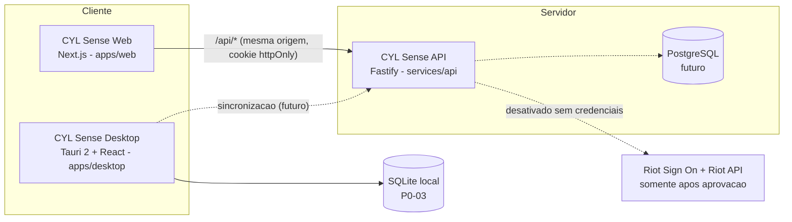

# Arquitetura v0.2 - CYL Sense (Web, Desktop, API)

> A v0.1 (somente desktop) esta resumida no fim deste documento. Decisao: [ADR 0002](../decisions/0002-separacao-web-desktop-api.md).

## Visao geral

| Produto | Papel | Estado na v0.2 |
|---|---|---|
| Web (`apps/web`) | Site institucional, login Riot, historico e analises iniciais, convite ao desktop | Estrutura minima executavel: landing, `/entrar`, `/partidas` (demo), `/download` |
| Desktop (`apps/desktop`) | Ferramenta principal: analise aprofundada, video manual, CYL Coach, funciona offline | Inalterado (shell do P0-01) |
| API (`services/api`) | Autenticacao, integracao Riot, sincronizacao idempotente, servicos compartilhados | Estrutura minima executavel; Riot **desativada**, modo `mock` so em desenvolvimento |

## Pacotes compartilhados

| Pacote | Responsabilidade | Consumidores |
|---|---|---|
| `@cyl/config` | `tsconfig.base.json` strict | pacotes e API |
| `@cyl/contracts` | Schemas Zod versionados (`CONTRACTS_VERSION`, `schemaVersion`) do dominio e da API HTTP | web, API, adaptadores, desktop (P0-02) |
| `@cyl/core` | `Result`, `ProviderError`, `parseWith` e as portas `AuthProvider`, `RiotAuthProvider`, `MatchProvider`, `RiotMatchProvider`, `GameAdapter`, `MatchNormalizer` | API, adaptadores, desktop |
| `@cyl/game-adapter-valorant` | Valida e normaliza partidas para `Match`. Hoje so o formato **sintetico** `cyl-synthetic-valorant` | API (mock), desktop (P0-02: fixtures; P0-04: importacao) |

Pacotes internos sao consumidos como TypeScript-fonte (`exports` -> `src/index.ts`), sem etapa de build: Vite, Next (`transpilePackages`), tsx e Vitest os compilam. Nao foram criados `ui`, `analytics` nem `coaching` porque ainda nao tem conteudo; entram em P0-05, P0-08 e quando o design system existir.

Regra de dependencia: `contracts` <- `core` <- `game-adapters/*` <- apps/servicos. Pacotes nunca importam apps; `contracts` e `core` nao dependem de Node, DOM ou Tauri.

## Camadas de dados

| Camada | Onde vive | Contrato |
|---|---|---|
| Dado externo bruto | So dentro do `MatchProvider` / `MatchNormalizer.parse` | `unknown` ate validar |
| Normalizado | `Match`, `MatchParticipant`, `Round`, `MatchEvent` (lados, condicao de vitoria, placar, `eventCoverage`; ausente != zero, ver `matchDataAvailability` e [ADR 0003](../decisions/0003-consistencia-e-cobertura-do-dominio.md)) | `@cyl/contracts` |
| Metricas calculadas | `MatchMetrics` (com `engineVersion` e `sampleSize`) | `@cyl/contracts` |
| Evidencias | `Evidence` (metrica, evento, round ou trecho de video); `checkFindingInContext` valida contra a sessao | `@cyl/contracts` |
| Diagnosticos | `Finding` = `fact` ou `hypothesis` (hipotese exige `confidence` < 1 e `limitations`); `sampleSize` opcional; sempre com evidencia | `@cyl/contracts` |
| Recomendacoes | `CoachingRecommendation` (exige `findingIds`) | `@cyl/contracts` |
| Video | `VideoReference` (offset) e `VideoMarker` (marcacao manual) | `@cyl/contracts` |
| Arquivo local | `LocalImportEnvelope` (`schemaVersion`, base das migracoes do P0-03) | `@cyl/contracts` |

Toda partida carrega `origin` (`synthetic`, `riot_api`, `user_import`). A UI e obrigada a sinalizar `synthetic`; a API expoe `containsSyntheticData` nas listagens.

## Integracao Riot (isolada)

Fluxo alvo: Usuario -> Web -> API -> Riot Sign On -> consentimento -> Riot API -> normalizacao -> persistencia -> Web/Desktop.

- Implementacoes reais ficam **somente** em `services/api/src/providers/riot.ts`. Hoje respondem `not_configured` e nao fazem nenhuma chamada de rede.
- `CYL_AUTH_MODE=disabled` e o padrao; `mock` usa provedores simulados e fixtures sinteticas e e **recusado** com `NODE_ENV=production`.
- O orquestrador OAuth ja esta pronto e testado com o provedor mock: `state` aleatorio de uso unico com TTL de 10 minutos, vinculado a cookie httpOnly; PKCE S256; troca de codigo no servidor; sessao em cookie httpOnly `SameSite=Lax` (`Secure` em producao).
- Endpoints, escopos e o formato do payload oficial **nao** foram definidos: a Riot so libera RSO para chaves de producao e inicia a integracao apos a aprovacao (ver [compliance](../compliance/riot.md)).

Detalhes das rotas, da seguranca e das variaveis de ambiente: [api.md](api.md).

## CYL Coach (hibrido)

- **Motor local** (desktop, P0-05/P0-08): metricas deterministicas, regras e padroes. Funciona offline e e o caminho principal.
- **Motor externo** (futuro): IA via API/gateway, opt-in por consentimento explicito, recebendo apenas evidencias selecionadas. Nenhuma chave no desktop. `AnalysisSession.engine` distingue `local_rules` de `external_ai`.

## Fronteiras de execucao

| Ambiente | Pode | Nao pode |
|---|---|---|
| Navegador (web) | Chamar `/api/*`, validar respostas com contratos | Ver tokens Riot, sessao legivel por JS, segredos |
| Servidor (API) | Guardar credenciais do provedor, falar com a Riot (apos aprovacao) | Logar `code`, `state`, cookies ou tokens |
| Desktop | Dados locais (SQLite, videos), analise offline | Embutir chaves, ler memoria do jogo, interagir com Vanguard |

---

## Arquitetura anterior (v0.1)

Monolito modular, local-first e somente desktop: `apps/desktop` (Tauri 2 + React + TS + Tailwind/shadcn), SQLite local planejado, importacao manual de MP4, IA opt-in futura. Os modulos de importacao, analytics, video e coaching continuam valendo e agora vivem no desktop sobre os pacotes compartilhados.
