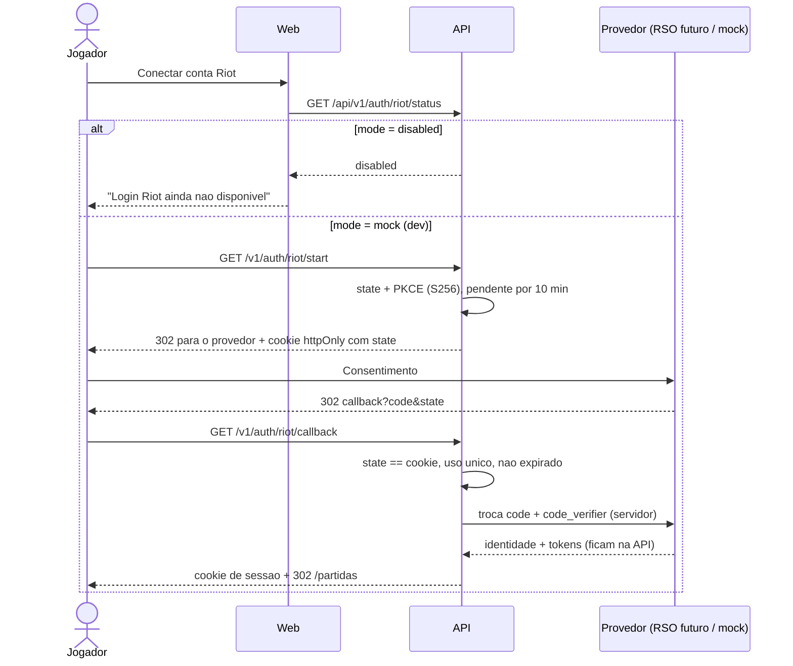
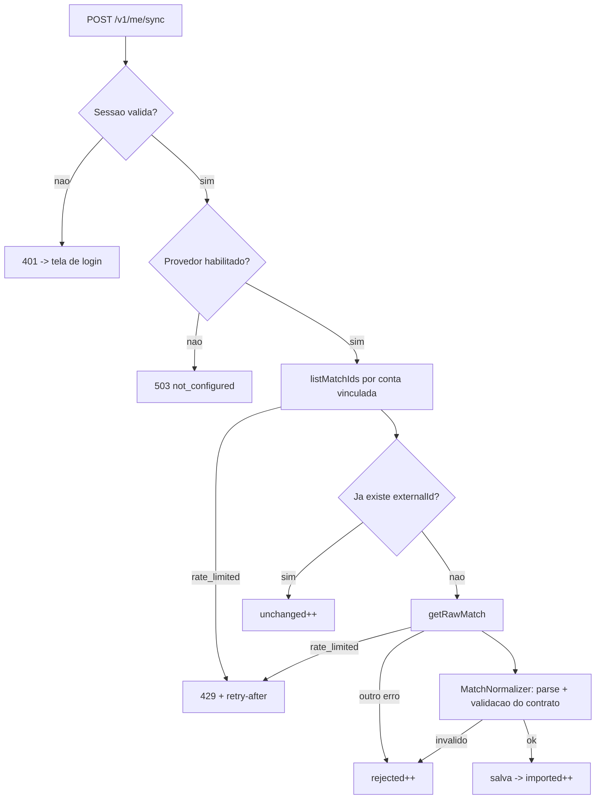
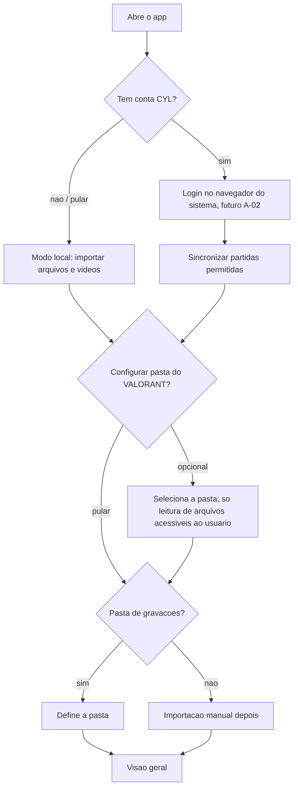
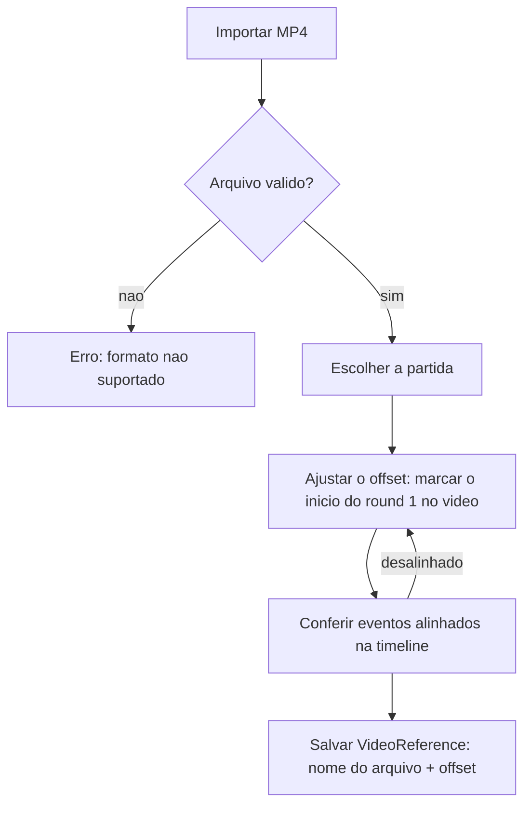
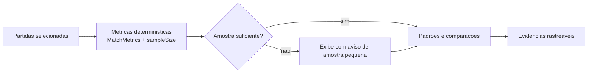
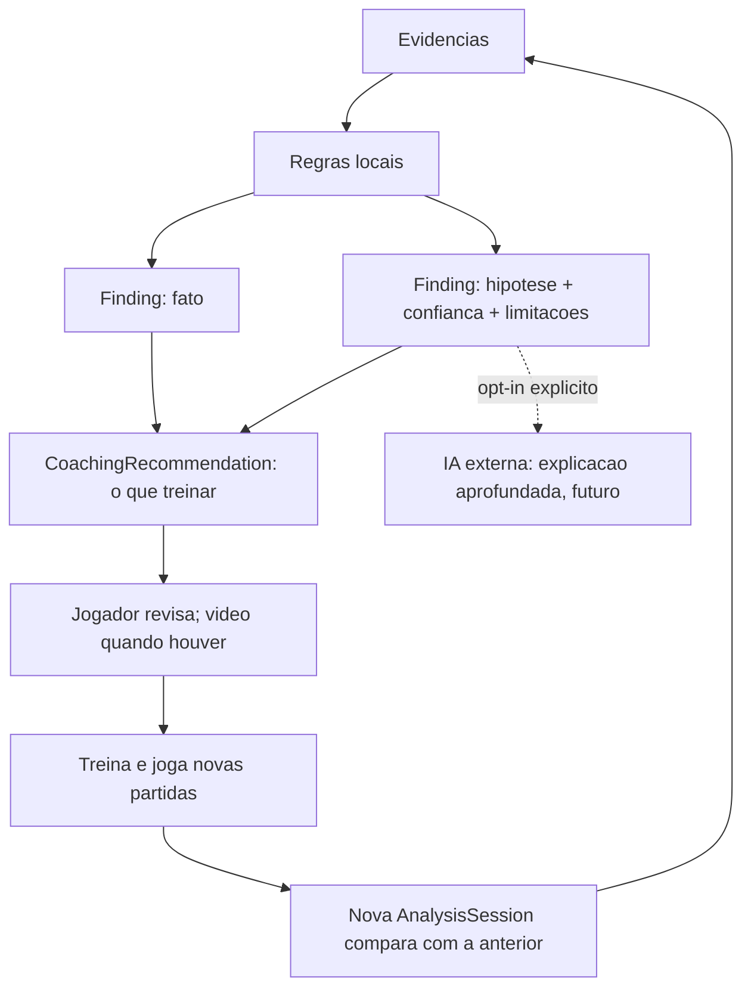
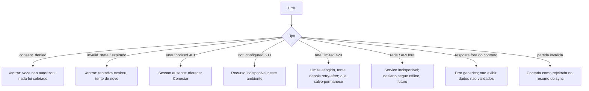

# Fluxos de interacao

Legenda: [impl] implementado, [sim] simulado, [futuro] planejado.

## 1. Jornada Web -> Desktop

Ver [user-journey.md](user-journey.md).

## 2. Autenticacao Riot

[impl] orquestracao (state, PKCE, sessao) - [sim] provedor mock - [futuro] RSO real, apos aprovacao da Riot.

## 3. Sincronizacao de partidas

[impl] idempotencia e erros - [sim] partidas das fixtures - [futuro] Riot API e sincronizacao do desktop.

## 4. Primeiro acesso no desktop

[impl] abertura e navegacao - [futuro] todo o resto.

## 5. Importacao manual de video

[futuro P0-07]. O video nunca sai do computador.

## 6. Analise estatistica

[futuro P0-05/P0-06].

## 7. Coaching e acompanhamento de progresso

[futuro P0-08]. IA externa somente opt-in.

## 8. Erros de autenticacao, rede e sincronizacao

[impl] na API e no web, exceto onde indicado.

