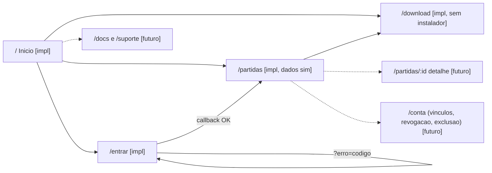
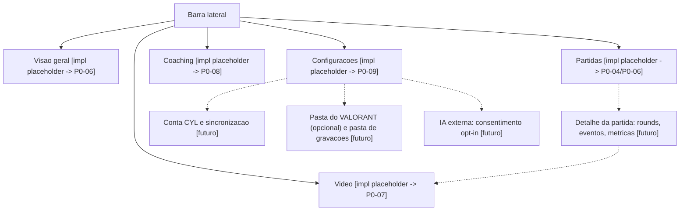

# Mapa de navegacao

Legenda: [impl] implementado, [sim] simulado, [futuro] planejado. Ver [user-journey.md](user-journey.md).

## Web (`apps/web`)

Cabecalho: Inicio, Minhas partidas, Desktop. O rodape traz o aviso de nao afiliacao a Riot.

## Desktop (`apps/desktop`)

Navegacao lateral fixa, ja implementada no P0-01 como placeholders:

