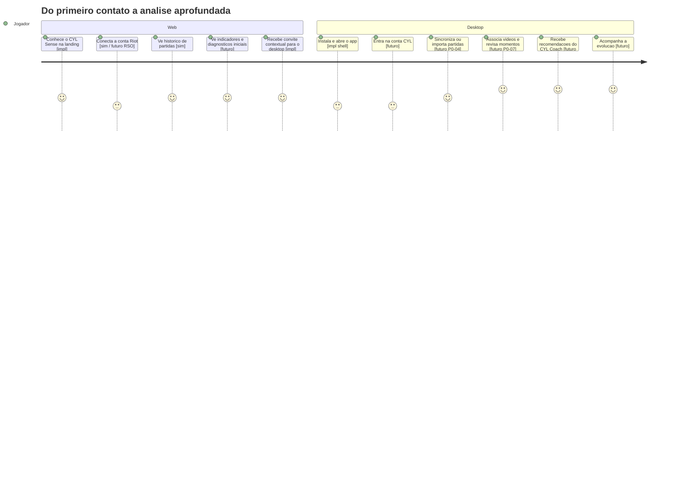
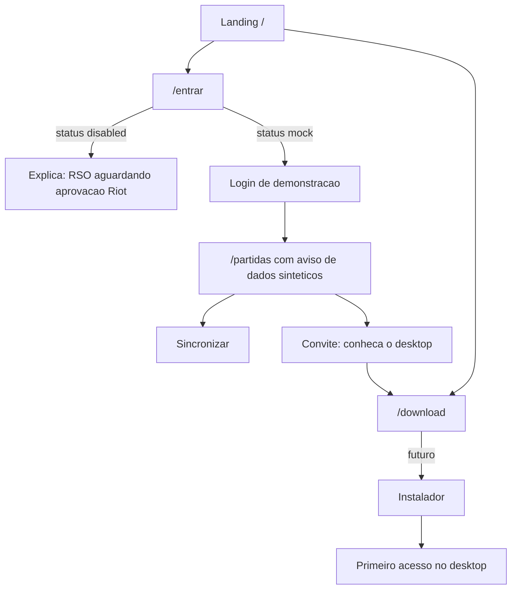

# Jornada do usuario

Legenda usada em todos os documentos de UX:

- **[impl]** implementado e funcionando
- **[sim]** simulado (modo `mock`, dados sinteticos; so desenvolvimento e demonstracao)
- **[futuro]** planejado, nao implementado

## 1. Jornada Web -> Desktop

## Principios de experiencia

- Estatistica mostra **o que** aconteceu, o video ajuda a ver **como**, e o coaching diz **o que treinar**.
- O convite ao desktop aparece quando agrega valor (depois de ver partidas), nunca como bloqueio.
- O desktop e util sem conta e offline. A conta so habilita a sincronizacao.
- Dado sintetico e sempre rotulado. Ausencia de dado aparece como ausencia, nunca preenchida.
